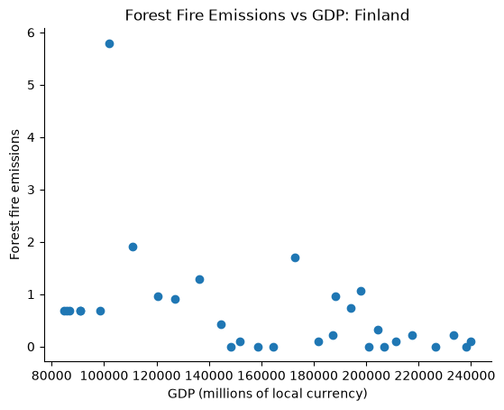
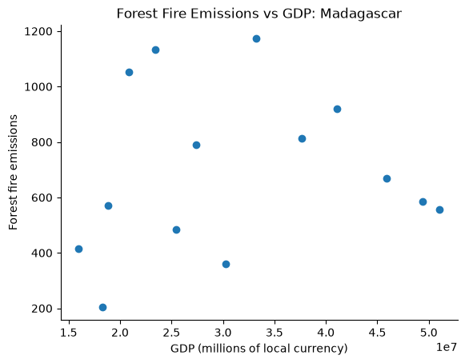
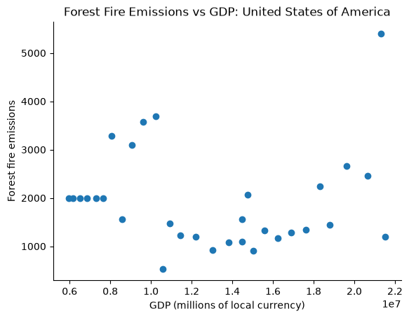
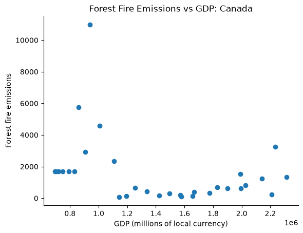
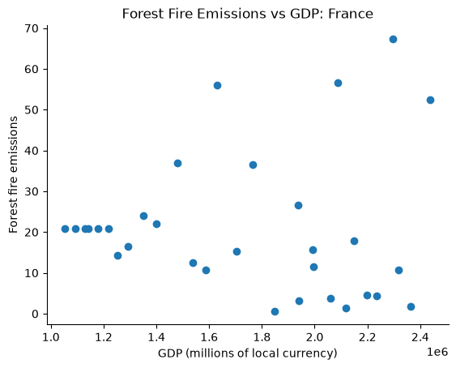
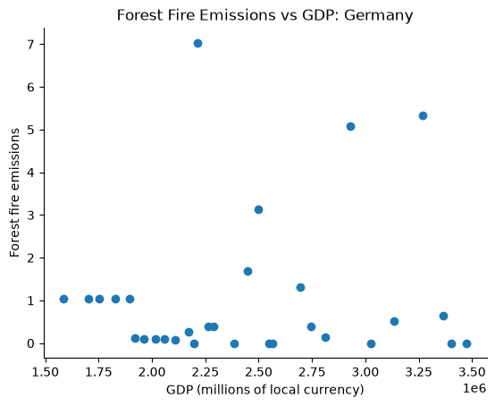

# Forest Fire Emissions and GDP

## Introduction

This project examines the relationship between forest fire emissions and GDP in Finland, Madagascar, and the United States, Canada, France, and Germany from 1990 to 2020.

**Hypothesis:** As GDP increases, forest fire emissions will decrease because economic growth may support better infrastructure for fire prevention and management.

Each country is analyzed separately because GDP is reported in local currency.

## Results

### Finland



Finland has a few spikes in forest fire emissions, but a minor and general downward trend as GDP increases.

### Madagascar



Madagascar shows no clear relationship between GDP and forest fire emissions, with considerable emissions fluctuations.

### United States



The United States shows little relationship between GDP and forest fire emissions, with emissions varying substantially.

### Canada



Canada shows generally lower forest fire emissions at higher GDP values, although several large spikes remain. This provides some support for the hypothesis.

### France



France shows considerable variation in forest fire emissions across GDP values, with no clear downward trend. This does not support the hypothesis.

### Germany



Germany shows mostly low forest fire emissions with occasional large spikes across GDP values. There is no clear relationship, providing little support for the hypothesis.

### Conclusion

The hypothesis is partially supported. Finland and Canada show some decrease in forest fire emissions as GDP increases, while Madagascar, the United States, France, and Germany show no clear relationship.

Although economic growth may support better fire management infrastructure, these results suggest that GDP alone does not explain changes in forest fire emissions.

## Methods

The analysis uses two datasets:

- `Agrofood_co2_emission.csv`: Forest fire emissions by country and year.
- `IMF_GDP.csv`: GDP by country and year.

Three functions in `src/fire_gdp.py` process the data:

- `get_data()`: Reads and filters CSV rows.
- `get_column_index()`: Finds a column by name.
- `get_fire_gdp_year_data()`: Matches forest fire emissions and GDP by country and year.

Years with missing values are excluded. The matched data is plotted using Matplotlib in `src/scatter.py`.

### Setup

Create and activate the Mamba environment:

```bash
mamba env create -f environment.yml
mamba activate tdd
```

Check both datasets are in the `data/` folder.

They can be downloaded by running:

```bash
curl -L "https://docs.google.com/uc?export=download&id=1AsXP_OGs1O_TDeXiZjk3fYV1SrG4vwXF" -o data/Agrofood_co2_emission.csv
curl -L "https://docs.google.com/uc?export=download&id=19YEPysdnK7VCXuAe9Og9pwYkNT5CbQzr" -o data/IMF_GDP.csv
```

### Generate Plots

Run these commands:

```bash
mkdir -p plots
```

**Finland**

```bash
python src/scatter.py --co2_file data/Agrofood_co2_emission.csv --gdp_file data/IMF_GDP.csv --country "Finland" --output_file plots/finland.png
```

**Madagascar**

```bash
python src/scatter.py --co2_file data/Agrofood_co2_emission.csv --gdp_file data/IMF_GDP.csv --country "Madagascar" --output_file plots/madagascar.png
```

**United States**

```bash
python src/scatter.py --co2_file data/Agrofood_co2_emission.csv --gdp_file data/IMF_GDP.csv --country "United States of America" --output_file plots/usa.png
```

**Canada**

```bash
python src/scatter.py --co2_file data/Agrofood_co2_emission.csv --gdp_file data/IMF_GDP.csv --country "Canada" --output_file plots/canada.png
```

**France**

```bash
python src/scatter.py --co2_file data/Agrofood_co2_emission.csv --gdp_file data/IMF_GDP.csv --country "France" --output_file plots/france.png
```

**Germany**

```bash
python src/scatter.py --co2_file data/Agrofood_co2_emission.csv --gdp_file data/IMF_GDP.csv --country "Germany" --output_file plots/germany.png
```

The plots will generate into the plot folder.

### Snakemake

Alternatively, the plots for all six countries can be generated using the `Snakefile`. Snakemake uses variables, wildcards, and `expand()` to automate the plotting process without repeating rules.

Preview the workflow without executing it:

```powershell
snakemake --dry-run --printshellcmds --cores 1 --forceall
```

Generate all plots:

```powershell
snakemake --cores 1
```

Regenerate all plots:

```powershell
snakemake --cores 1 --forceall
```

Generate a dependency graph using Graphviz:

```powershell
snakemake --dag | dot -Tpng -o dag.png 2>$null
```

### Testing

Unit tests use Python's `unittest` framework. Functional tests use `ssshtest`.

Run unit tests in Bash:

```bash
mamba activate tdd
PYTHONPATH=src python test/unit/test_fire_gdp.py -v
```

Run functional tests in Git Bash:

```bash
bash test/func/test_fire_gdp.sh
```

GitHub Actions is configured to run the unit tests, functional tests, and style checks.

### Workflow Testing Approaches:

- **Output verification:** Confirm that all expected output files are generated and contain valid results.
- **Missing input testing:** Remove an input file in a test environment and verify that the workflow reports an error.
- **Data validation:** Test datasets with missing or invalid values to verify that they are handled correctly.
- **Dry-run testing:** Use `snakemake --dry-run --printshellcmds` to verify the workflow's commands without executing them.
- **Incremental execution testing:** Run Snakemake twice and verify that unchanged outputs are not regenerated.
- **Missing output testing:** Delete one plot and verify that Snakemake regenerates only the required output.
- **Wildcard testing:** Verify that each wildcard selects the correct country and generates the corresponding plot.

## Author

Samantha Veitch